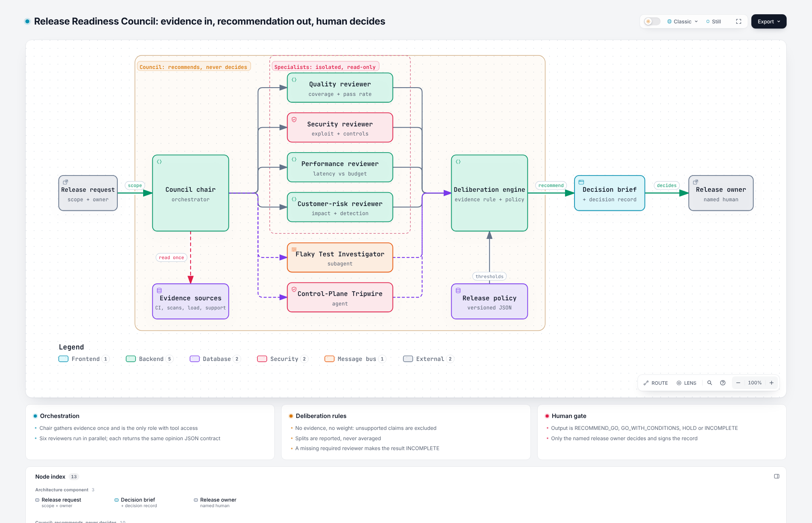

# Release Readiness Council

**A multi-agent go/no-go review where specialists disagree in the open, every claim needs evidence, and a named human makes the call.**

[](https://github.com/j-m-o/release-readiness-council/actions/workflows/ci.yml)
`Type: Orchestration` · `Parallel specialists + subagents` · `Policy as code` · `Python stdlib, no network`

Created by **Jessica Mosley** | [LinkedIn](https://www.linkedin.com/in/jessmosley/) | [GitHub](https://github.com/j-m-o/)
Portfolio concept and original framework | Version 1.0.0 | November 2026

## Why I built this

I have sat in a lot of go/no-go meetings. They tend to fail the same two ways: the most senior or loudest voice wins, or every concern gets blended into a vague "yellow" that nobody owns. Neither gives the accountable leader what they need: **the trade-offs, the evidence behind each one, and where the experts actually disagree.**

The council is built to fix that. It treats disagreement as information, refuses to let unsupported opinions drive the outcome, and never pretends an AI made the decision.

## How it works

<picture>
  <source media="(prefers-color-scheme: dark)" srcset="docs/architecture/release-readiness-council-dark.png">
  
</picture>

**[Open the interactive diagram](https://j-m-o.github.io/release-readiness-council/docs/architecture/release-readiness-council.html)** (zoom, focus, trace routes, light and dark). Built with [Archify](https://github.com/tt-a1i/archify) from the typed source in [`docs/architecture/release-readiness-council.architecture.json`](docs/architecture/release-readiness-council.architecture.json), validated and browser-checked before publishing.

1. The chair gathers evidence **once** and is the only role with tool access.
2. Four specialists review **in parallel and in isolation**, so none anchors on another.
3. Two external pieces plug in through stable contracts: [Flaky Test Investigator](https://github.com/j-m-o/flaky-test-investigator) (subagent) and [Control-Plane Tripwire](https://github.com/j-m-o/control-plane-tripwire) (agent).
4. A deterministic engine applies the rules: no evidence, no weight; missing is not GO; splits and contradictions are shown, not averaged.
5. The output is a **recommendation** and a blank decision record for the owner.

## See it on a fictional release

```bash
cd skills/release-readiness-council/assets/fixtures
python ../../scripts/council.py release-4.2
```

Release 4.2 (checkout redesign) is built to be messy, like real releases:

- Quality says **GO**, at 96 percent passing, but only after quarantining flaky tests. The Flaky Test Investigator finds one of them is a **real regression**. The council flags the contradiction.
- Security says **HOLD**: a new payment endpoint lacks an authorization test.
- Control-Plane Tripwire finds a bot **removed the `security-scan` required check and approved its own change**. That is likely why CI never caught the security gap.
- Performance says **GO with conditions**: p95 up 18 percent, inside budget, ship behind a ramped flag.
- Customer risk says **GO**, and adds "enterprise customers will love it" with no evidence. That claim is **excluded**.

Result: `RECOMMEND_HOLD`, four evidenced blocking findings, a visible split, and a decision record waiting for the VP of Engineering.

```bash
python -m unittest discover -s tests -v   # from repo root
```

## Design choices that matter

| Choice | Why |
| --- | --- |
| Only the chair has tool access | One permission boundary to review and audit |
| Specialists run isolated and in parallel | Avoids anchoring and groupthink |
| Evidence required for every finding | Recommendations a leader can defend |
| Splits reported, never averaged | Disagreement is the most useful signal |
| `INCOMPLETE` when a reviewer is missing | Silence is not approval |
| Recommend only; human signs the record | Accountability stays with a named person |
| Policy in versioned JSON | Thresholds change through review, not per release |

## Install

| Option | Use |
| --- | --- |
| `agents/*.md` | Copy to `.claude/agents/`: the chair plus four specialist subagents |
| `dist/release-readiness-council.zip` | Upload as a skill (Claude, Agensi or any SKILL.md agent) |
| `skills/release-readiness-council/` | Copy into `~/.claude/skills/` |

## Part of a connected portfolio

| Repo | Pattern |
| --- | --- |
| [Quality Engine](https://github.com/j-m-o/Quality-Engine) | Orchestrator + specialists for feature readiness |
| **Release Readiness Council** | Orchestration |
| [Control-Plane Tripwire](https://github.com/j-m-o/control-plane-tripwire) | Agent |
| [Flaky Test Investigator](https://github.com/j-m-o/flaky-test-investigator) | Subagent |
| [AI Assurance Loop](https://github.com/j-m-o/ai-assurance-loop) | Loop engineering |

## Business value

Release risk made visible before the meeting, lower escape rate, faster and better-documented go/no-go decisions, and an audit trail of who accepted which risk. Consulting use: **release governance and policy-as-code** engagements.

## Limits

Reference implementation with fictional data. The deliberation rules are a proposed framework, not a validated scoring model. Teams should tune policy thresholds to their own risk appetite.

See [NOTICE.md](NOTICE.md) for authorship and reuse terms.
